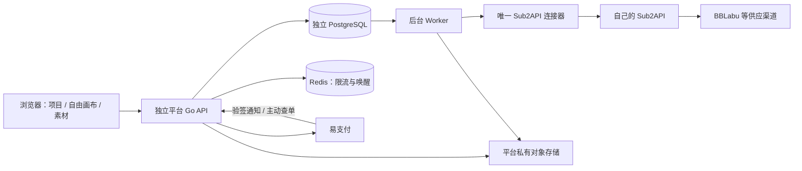

# 独立图片与视频创作平台开发计划

日期：2026-10-18

项目目录：`D:\Code\Other\wsapi-video`

最新目标与本轮交付：图片/视频生成直接显示在当前创作节点，等待、生成中、归档、失败及再次生成均原地更新，不自动新增旁边的结果节点。历史任务、输入/价格快照、账务和素材继续保留。已处理旧回执、删除节点后的迟到回执、自引用和快速完成任务的素材补取。前端 170/170、格式/类型/许可/构建及 25 项隔离浏览器检查通过，详见[当前节点生成验收](QA_INPLACE_GENERATION_2026-10-18.md)。发布目标为 v0.1.7，无新增依赖或迁移。

上一轮交付：已完成“先创建节点，再点击节点就地创作”的画布改造。图片/视频占位卡、节点旁提示词与可视化参考/首尾帧、参数浮层、双击创建、拖线续建、节点草稿及跨节点提交恢复已接入现有服务。前端 162/162、后端全量 race/vet、18 项全拦截浏览器检查通过，详见 [节点创作验收](QA_NODE_COMPOSER_2026-10-18.md)。其中自动追加独立结果节点的行为已被本轮目标替换；其余检查保留为当时版本的证据。下述 r13/r14 等内容同样为历史验收记录。

状态：用户已批准视觉方案和自由画布创作范围。r13 已修复商品定义变化清验证下架、视频固定分辨率协议及参考总量文案，见 [r13 验收](QA_CATALOG_CONTRACT_2026-10-18.md)。前端 142/142（0 skip）、格式/类型/许可/构建及 14 项全拦截浏览器检查通过；后端全量 race/vet 通过，15 包 PASS、3 包无测试、255 个测试 PASS 事件及 1 项 Windows 符号链接权限 skip。[r12 验收](QA_CANVAS_RECOVERY_2026-10-18.md) 保留实际生成输入与恢复等记录，原生下载未验证成功。浏览器真实业务写、模型调用与费用均为零；本轮未启动应用、应用迁移或部署，E1–E11 外部/生产验收见[上线清单](RELEASE_READINESS.md)。当前覆盖见 [实施状态](IMPLEMENTATION_STATUS.md)。

## 1. 需求依据与当前事实

r14 交付核查补充：已修复首装 smoke 与结构化日志契约不一致，完成匹配 r13 应用源码的双平台构建、前端/许可配套和候选 ZIP 逐文件校验，见 [发布候选验收](QA_RELEASE_CANDIDATE_2026-10-18.md)。应用源码与前端未新增功能，本轮没有启动应用、部署或真实服务联调；E1–E11 继续待验。

已阅读目标会话 `01a1347a-be4d-7952-bead-0b810fb4ab88` 的全部 5 个可见对话轮次，重点采用后续需求与用户修正。旧会话中的设计文档是规划依据，不代表功能已经实现，也不把所有设计建议视为用户逐项批准。

**最新范围修正优先：用户不需要分镜，用户在画布自由创建图片和视频，通过连线处理提示词、参考素材与结果之间的关系。** 参考 [basketikun/infinite-canvas 固定提交](https://github.com/basketikun/infinite-canvas/tree/3a6b64b602ad062b29fac66902ed18a7ef5fd9dc)。下述当前计划据此更新；旧 PRD、早期方案或历史验收中的分镜、镜头排序和选定成品导出不再构成当前需求。

需求依据：

- [独立创作平台 PRD](D:/Code/Other/sub2api/docs/superpowers/specs/2026-10-17-creative-platform-prd.md)。
- [当前与计划媒体契约](D:/Code/Other/sub2api/docs/superpowers/specs/2026-10-17-public-media-contract.md)。
- [网关通用视频接入设计](D:/Code/Other/sub2api/docs/superpowers/specs/2026-10-17-video-tasks-json-v1-design.md)。
- [早期方案及 infinite-canvas 评估](D:/Code/Other/sub2api/docs/CREATIVE_PLATFORM_PROPOSAL.md)，遇冲突以较新的范围为准。

用户已经直接明确的要求：

1. 新平台专做图片、视频创作；账号、余额、订单与 Sub2API 完全独立，支持易支付。
2. 生成能力必须经过自己的 Sub2API，对接固定公开格式。
3. 主要面向图片与视频的自由画布创作，以项目管理作品，通过连线表达提示词、参考素材和生成结果的关系；不需要手动分镜或镜头流程。
4. 首期不建设团队成员体系，允许共用一个账号、共用积分。
5. Sub2API 另有通用视频接入、上游模型发现及按视频条数计费需求；新平台需与这项网关工作配合。
6. 先创建图片/视频节点，再点击节点就地编辑提示词、参考素材和参数；生成等待与结果显示在当前节点，再次生成原地更新，历史任务和素材仍可查询及使用。

据此采用的设计基线：React/TypeScript 与固定版本 infinite-canvas；项目、自由画布、提示词和参考关系、当前节点生成与历史素材、素材与任务中心；服务端报价、冻结、归档后结算。账号、计费和运营后台继续保留，不增加组织、协同或剪辑系统。

规划时核查事实（以下为开发启动前快照，当前工程与验收状态以实施状态文档为准）：

- 新项目目录为空，未初始化 Git，没有可继承的代码、依赖、数据库或测试。
- 本地 Sub2API HEAD 为 `ce0e27f51d2020ccf66b91a8c9582c6a4987cc04`；后续检查发现另一项任务正在该目录进行未提交的媒体改造。新平台不修改该工作区，新增接口的生产部署状态未核实。
- infinite-canvas 本次重新静态核查固定提交 `3a6b64b602ad062b29fac66902ed18a7ef5fd9dc`，不自动跟随其主分支；未运行其构建。
- 当前会话未暴露 `code-editor:set_root_path` 工具；本次以明确工作目录与绝对路径限定操作，未声称已调用该工具。

## 2. 产品定位与首发边界

平台的核心业务链路是：

**项目 → 创建并点击图片/视频节点 → 编辑提示词/参考素材 → 当前节点生成与展示 → 再次生成或继续引用/下载。**

例如在画布创建图片节点，点击后输入提示词并连接商品原图，明确确认报价后在该节点查看等待状态和生成图片；可以在此节点再次生成，也可把当前图片作为参考连接到新的图片或视频创作。每次任务仍独立保留输入、参数、来源、素材和积分消费，用户可从任务中心与素材库查找历史作品。

首发按下列范围实施：

| 模块       | 首发交付                                                               | 关键边界                                       |
| ---------- | ---------------------------------------------------------------------- | ---------------------------------------------- |
| 独立账户   | 邮箱注册验证、登录、找回/修改密码、退出、会话撤销、多设备登录          | 数据和钱包归账号，不识别共用账号背后的不同人员 |
| 项目       | 新建、重命名、搜索、封面、最近编辑、归档恢复、受控删除                 | 归档不取消任务、不退款、不删除作品             |
| 无限画布   | 文本/媒体/生成节点、缩放拖拽、多选分组、连线、撤销重做、预览、云端保存 | 连线表示素材引用与来源；逐节点显式生成         |
| 图片创作   | 文生图、参考图编辑、当前节点展示与再次生成                             | 默认每任务一张；编辑能力按实际联调结果开放     |
| 视频创作   | 文生视频、图生视频及模型支持的参考模式                                 | 每任务一条；参数由已验证商品能力控制           |
| 素材与作品 | 上传、筛选、预览、引用关系和单文件下载                                 | 私有存储，长期保存自己的 object key            |
| 任务中心   | 项目/类型/状态筛选、输入与价格快照、进度状态、异常说明                 | 不伪造百分比；刷新和重新登录后可继续查询       |
| 钱包与充值 | 可用/冻结积分、充值档位、订单、消费/释放/退款流水、易支付              | 用户余额与网关采购余额分别管理                 |
| 基础后台   | 用户状态、商品/价格、订单查单补单、任务异常、调账退款、审计            | 平台运营权限，不建设客户团队角色体系           |

画布节点及素材操作复用相同的报价、任务和素材服务，生成状态与结果在当前图片/视频节点展示；再次生成更新当前展示，历史任务和素材继续保留。当前结果可继续作为参考；连线及布局编辑不自动执行生成。

首发不包含手动分镜、镜头排序、镜头候选/选定成品及按选定镜头导出，也不包含成员邀请、工作空间、成员预算、实时协作、CRDT、整图自动运行、完整视频剪辑/合片/转码、社区、分销、会员订阅、对外售卖 API、多供应商直连或可编程插件。历史后端 shots 数据、接口及已应用迁移保持兼容，不作破坏性清理，也不计作当前产品功能。

桌面优先；窄屏覆盖任务查询、预览、下载、充值。工作台采用深色背景、紧凑参数区和大预览，借鉴参考站的使用效率；自有品牌和示例素材另行确定。中英文及加载、空、失败、冲突、余额不足状态纳入交付。

## 3. 系统架构与职责

采用独立仓库、一个模块化 Go 后端及后台 Worker；首期可在同一应用进程部署，不拆微服务。前端基于 infinite-canvas 的 React/TypeScript；PostgreSQL 保存业务事实，Redis 用于限流/唤醒，私有 S3/R2 保存媒体。



职责分配：

- 新平台负责登录、项目、画布、素材、商品零售价、钱包、充值、零售任务和交付。
- Sub2API 负责供应商协议差异、上游账号、模型能力、渠道调度及网关侧计费。
- 浏览器只调用新平台业务 API；不接触服务 Key、上游任务接口和供应商配置。
- 本项目只实现一个 Sub2API 连接器，不复制 BBLabu 适配器或 Sub2API 管理端。
- 图片和视频分别配置服务凭证；每个任务绑定创建时的原凭证引用。轮换不能使在途任务失去查询和下载权限。
- 新平台和 Sub2API 不共享业务数据库，不为每个新平台用户创建影子网关用户，不同步两边余额。

建议工程结构如下，实际初始化时固定依赖与锁文件：

```text
D:\Code\Other\wsapi-video\
  web\                  React 工作台与基础管理页面
  backend\              Go API、Worker、业务模块与测试
    migrations\         仅新增的数据库迁移
  docs\                 需求、接口、验收与运维说明
  deploy\               容器、反向代理与环境配置示例
```

基础后台与工作台共用前端工程、后端服务与账务规则，按路由和服务端权限隔离。数据库/对象存储是持久事实，画布本地缓存和 Redis 丢失不应造成余额或作品事实丢失。

## 4. infinite-canvas 复用与裁剪计划

它是完整应用，不能只改 Base URL 后直接作为商业平台上线。采用固定源码版本，保留画布交互和现有可用状态管理；新业务不再依赖原应用的个人配置和本地项目系统。

本次源码核查补充：固定版本声明 React 19.2.5、Vite ^7.3、TypeScript ^5，使用 Zustand/TanStack Query，画布不是 React Flow。用户 store 只有占位状态，项目存于 localforage，媒体以 IndexedDB Blob 保存；画布主页面约 3,477 行且直接耦合生成、配置、存储和插件。前期估算包含这部分调用/持久化边界改造，而非假设已有认证或云端项目。

构建配置还读取父目录 VERSION、CHANGELOG.md 并处理插件清单；引入源码时同步核查这些构建输入，不能只复制 web 后假定能直接构建。具体依赖按保留功能和锁文件确认，不为技术新旧而整体升级。

源码依据：[package.json](https://github.com/basketikun/infinite-canvas/blob/3a6b64b602ad062b29fac66902ed18a7ef5fd9dc/web/package.json)、[画布主页面](https://github.com/basketikun/infinite-canvas/blob/3a6b64b602ad062b29fac66902ed18a7ef5fd9dc/web/src/pages/canvas/project.tsx)、[画布 store](https://github.com/basketikun/infinite-canvas/blob/3a6b64b602ad062b29fac66902ed18a7ef5fd9dc/web/src/stores/canvas/use-canvas-store.ts)、[构建配置](https://github.com/basketikun/infinite-canvas/blob/3a6b64b602ad062b29fac66902ed18a7ef5fd9dc/web/vite.config.ts)。

| 层次         | 处理方式                                         | 验收证据                                          |
| ------------ | ------------------------------------------------ | ------------------------------------------------- |
| 画布交互     | 保留节点、连线、缩放、多选、分组、预览、撤销重做 | 基础交互回归及大媒体预览检查                      |
| 模型调用     | 替换为平台商品、报价、任务 API                   | 浏览器请求清单仅有平台业务端点及授权媒体 URL      |
| Key/地址设置 | 从运行路径移除任意 Key、Base URL 和原始请求配置  | 无可执行直连分支，无密钥落入前端存储或构建产物    |
| 扩展执行     | 裁剪动态模型脚本、远程插件、本地 Agent 连接      | 扫描与实际运行确认没有可达入口，不能仅隐藏按钮    |
| 项目保存     | 云端项目和版本保存成为主数据源                   | 刷新恢复、跨设备打开、旧 revision 保存冲突        |
| 媒体存储     | Blob/WebDAV 主存储替换为平台 asset 引用          | 重新登录/换设备后素材可用，上传前 Blob 不传给上游 |
| 任务执行     | 浏览器轮询/中断替换为后端任务服务                | 关闭页面任务继续，恢复后状态一致                  |
| 开源许可     | 保留 LICENSE、版权与归属；核对 README 标识要求   | 发布包开源清单与实际页面归属检查                  |

裁剪顺序：先跑通固定基线 → 识别 store/API/配置依赖 → 切断外部执行入口 → 接入登录和项目 → 接入 asset → 接入平台任务。保留仍被使用的交互依赖，不以本次需求为由重写整个画布。

许可证方面，本次重新核查固定版 LICENSE 为 MIT，README 另有前端标识表述；两者不混作 MIT 正文条款。商业发布保留许可与归属；关于页是否已满足其前端标识表述需核对，彻底白标不作已解决承诺。第三方示例图和素材不自动随 MIT 获得使用权。

## 5. 项目、画布、任务与作品的数据规则

画布、任务和素材必须分开：画布保存自由布局、提示词和引用关系；任务保存不可变执行和收费事实；素材保存文件及其元数据。画布 JSON 不可回写任务成功、金额或退款状态。

同一项目的画布、素材与任务中心使用相同 task/asset ID；节点引用作品，不复制媒体。图片/视频节点提交后原地显示当前任务状态与结果，再次生成更新该节点的当前任务引用和展示；旧任务、不可变快照及归档文件保持独立，不因节点更新而删除或改写。不要求先选定镜头成品。

画布保存包含 `graph_schema_version` 和 `revision`。服务端按期望 revision 原子更新；两个设备同时编辑时，旧版本写入返回 409。前端保留冲突草稿，允许重载或另存项目副本，不静默覆盖。

云端自动保存必须显示保存中、已保存、失败、冲突。本地草稿按账号和项目隔离，退出或切换账号时清理当前账号缓存，禁止用另一账号缓存恢复项目。

连线明确表达提示词、参考素材、生成构想和结果的关系，不根据节点位置推断执行顺序。用户逐次确认报价后提交生成；已有结果可连接到下一次创作，也可直接预览和下载。

移动、复制、连线、撤销、删除节点不触发生成、取消、退款或再次扣款。编辑提示词/素材只影响下一次提交，历史任务输入保持不变。删除/归档项目不应让仍在执行的任务与素材失联。

核心存储分组：

| 分组       | 主要记录                        | 必须保存的事实                                                    |
| ---------- | ------------------------------- | ----------------------------------------------------------------- |
| 账户       | users、sessions、验证/重置记录  | 账号状态、会话期限及撤销                                          |
| 项目       | projects、canvases              | 所属账号、版本、节点布局、提示词及素材引用关系                    |
| 执行       | generation_tasks、task_attempts | 请求摘要、报价/输入快照、执行租约、上游 ID、原 Key 引用、各类状态 |
| 媒体       | assets、必要的引用关联          | object key、所有权、来源、大小、实际格式、尺寸/时长               |
| 商品       | model_products、quotes          | 能力版本、允许参数、价格版本、有效期、固定积分                    |
| 账务       | wallet_accounts、wallet_ledger  | 可用/冻结整数余额、不可变事件、唯一业务去重键                     |
| 支付与运营 | payment_orders、admin_audit     | 金额/积分快照、支付与到账状态、操作原因和前后状态                 |

关联表按实际查询与完整性需求增加，不预建未来组织模型。素材删除检查画布/任务及仍存在的历史引用；在途依赖保留至安全清理时点。永久任务快照中记录素材身份，不把会过期的签名 URL 当素材身份。历史 shots 记录、兼容 API 和已应用迁移保留，不再为其新增用户流程或要求验收镜头功能。

## 6. 生成协议与网关依赖

### 6.1 当前可依赖的公开路径

| 功能         | 固定调用路径                        | 当前边界                                        |
| ------------ | ----------------------------------- | ----------------------------------------------- |
| 异步文生图   | `POST /v1/images/generations/async` | 需网关开启异步和对象存储                        |
| 异步图片编辑 | `POST /v1/images/edits/async`       | 真实型号和请求组合仍需验证                      |
| 图片查询     | `GET /v1/images/tasks/{id}`         | processing/completed/failed；成功读 result.data |
| 视频创建     | `POST /v1/videos/generations`       | JSON，202，现有统一链路由 Seedance 分组承载     |
| 视频查询     | `GET /v1/videos/{id}`               | queued/in_progress/completed/failed/canceled    |
| 视频取回     | `GET /v1/videos/{id}/content`       | Worker 携原 Key 下载，支持 Range                |
| 视频取消     | `DELETE /v1/videos/jobs/{id}`       | BBLabu 进行中当前返回 501，不能承诺取消         |

视频规范字段为 `model/prompt/duration/resolution/aspect_ratio/audio/referenceImages/referenceVideos/referenceAudios/start_frame_url/end_frame_url`，具体允许组合由模型能力决定，不向所有型号发送相同可选字段。

视频对象当前固定为 `id/object/status/model/resolution/duration/content_url/error`。图片和视频响应结构不同，由连接器归一成平台任务；前端不直接理解两套网关结构。网关 ID 一律当不透明字符串。

当前 referenceVideos 只接受 HTTPS 字符串数组，素材时长对象属于计划扩展。平台自己的后端严格验证整数时长和规格，不依赖网关的宽松转换；JSON 图片编辑按现有 `images[].image_url`、`mask.image_url` 契约联调。视频回显的 duration/resolution 是请求规格，不作为实测媒体元数据。首期没有已核实 webhook，使用后台轮询。

### 6.2 尚未实现的网关工作

以下是独立的 Sub2API 开发任务，不在本项目通过供应商直连绕过：

- Video Tasks JSON v1、可配置同协议供应商和上游模型发现。
- BBLabu 全部视频型号的能力映射、参数限制、适用价格及按条/按秒计费。
- 剩余图片型号准入及对应能力验证。
- 计划中的 `GET /v1/media/models` 能力目录、价格单位与版本输出。
- 新网关随机任务 ID，以及部分型号参考视频时长对象的扩展。

`/v1/models` 不能替代完整能力/价格目录。新平台的可售商品由后台明确上架；同步发现型号不自动售卖。未就绪时，可先使用人工配置、经过验证的能力条目开展开发和受控联调，不能宣称 33 个视频型号已可用。

内部首条链路只选择一款图片、一款视频完成验证，再扩展矩阵；这不缩小网关全型号适配目标。正式上架的每个规格必须同时满足能力已确认、Key 有权调用、网关价格完整、真实生成和媒体取回通过。

现有网关用户 JWT 接口 `/api/v1/video-assets` 和 `/api/v1/studio/tasks` 不用于新平台独立用户；素材、历史和归属由新平台自行管理。

### 6.3 连接器约束

固定 Sub2API origin、HTTP 方法和路径；从平台商品/素材构建白名单字段，禁止原始 JSON 透传。`content_url` 只接受已知网关路径；素材 URL 由服务端为本人资产生成。归档下载验证目标/重定向及媒体大小，不能携服务 Key 跟随到任意域名。

网关 Key 当前没有通用端点 scope，方法/路径约束由连接器和部署代理落实；模型白名单、出口 IP、预算继续在网关设置。服务 Key 仅后端可见，平台域名不提供任意 `/v1/*` 代理。

## 7. 报价、积分钱包与可靠任务

### 7.1 正常流程

**校验输入 → 服务端报价 → 事务建任务并冻结 → Worker 提交 → 保存上游 ID → 查询原任务 → 归档 → 事务结算。**

人民币使用整数分，积分使用整数最小单位。商品和充值兑换规则版本化，计算舍入规则明确；不以浮点数保存财务事实。

报价绑定账号、项目、商品、模型/能力版本、全部输入摘要、素材、零售价和有效期。提交只接受报价 ID 与本地去重键，客户端不能指定应扣金额。输入改变则重新报价；已被接受的任务保留其固定价，后台改价不追扣。

视频一任务一条，图片默认一任务一张。多候选显示总费用并拆成多个独立报价和任务，各自成功/失败结算；创建到一半余额不足时，清楚列出哪些任务已受理，不隐式无限批量执行。

### 7.2 账务事务与去重

- `(account_id, request_key)` 唯一，并保存请求摘要；同键同内容返回原任务，同键不同内容返回 409。
- 重复请求先查已受理结果，再处理新报价有效性，避免已成功提交后的重试被错误作为新任务。
- 钱包余额检查、冻结变更、任务创建和唯一流水在同一 PostgreSQL 事务完成；采用行锁/条件更新防止共用账号并发透支。
- 冻结、消费、释放、退款都有唯一业务事件；多 Worker、重复查询、重复回调只产生一次相应账务结果。
- 退款新增反向流水，不修改历史；已经释放/退款的任务即使迟到完成也不得再次扣积分。
- Redis 只作辅助，不以 Redis 锁作为唯一扣费保护。

### 7.3 四类状态分别保存

| 维度     | 需要表达的事实                                             |
| -------- | ---------------------------------------------------------- |
| 生成执行 | 待发送、发送中、提交待确认、排队、生成中、成功、失败、取消 |
| 媒体交付 | 待取回、归档中、归档重试、已就绪、交付异常                 |
| 零售结算 | 已冻结、已消费、已释放、已退款                             |
| 采购对账 | 待核对、已核对、存在差异、人工决议                         |

对用户展示可理解的合并状态，但底层保留上述事实；“生成完成”与“已保存可下载”需区分。

Worker 使用 PostgreSQL 记录待执行状态、attempt、租约和重试时点。调用前持久化发送中与 attempt；拿到上游 ID 后只查询该任务。本平台进程重启后扫描任务，恢复已有 ID 的查询和归档，不依赖浏览器继续轮询；这不等于可以恢复网关内部已经丢失的生成。重试按退避与期限进行，任务创建不套用通用网络重试器。

### 7.4 异常必须有明确处理

| 情况                                                   | 处理与资金规则                                           |
| ------------------------------------------------------ | -------------------------------------------------------- |
| 输入错误/余额不足                                      | 不调用上游，不消费                                       |
| 明确未受理/业务终态失败                                | 按已公布政策幂等释放冻结；采购成本另核对                 |
| 发送后丢响应、202 后 ID 落库失败、无 ID 的发送租约过期 | 进入提交待确认，禁止自动重发；运营在规定期限内决议       |
| 已有 ID，查询超时/断网/暂时 404                        | 查询原任务，不能直接推断失败或重新生成                   |
| 上游已生成，平台归档失败                               | 只重试取回/存储，不再次生成、不重复计费                  |
| 网关图片任务显示失败但可能已计费                       | 零售按交付政策处理，采购核查；不能把网关失败等同采购退款 |
| 页面关闭/节点删除/撤销                                 | 后端任务继续，资金无额外变化                             |
| 取消不支持/未确认                                      | 提示任务仍继续，不按“停止浏览器请求”释放余额             |
| 退款后迟到成功                                         | 不再扣费；是否交付遵循预先公布政策                       |

当前网关没有公开创建幂等或按客户端键找回能力，本地去重无法保证跨系统恰好一次。未知提交要有处理期限、冻结逾期告警、后台核查与审计，不能无限挂起。

网关图片任务为 Redis 记录加本进程 goroutine 执行，创建/终态更新后 TTL 约 24 小时、最长执行约 30 分钟，查询不续 TTL。当前不具备网关进程重启续跑能力，旧记录可能一直 processing 至过期；这已经从实现核实，不只是待测猜测。生成后网关转存失败也可能已经计费。新平台无法仅靠自己的 Worker 修复此类生成丢失，不得自动重发。

图片正式收费发布前，要么在 Sub2API 补齐持久执行/结果恢复并通过故障测试，要么明确采用受控运营、超时核查和退款政策且保留该能力限制；不能把后者宣传成完整自动恢复。网关改造不在本项目中顺手实施。

新平台零售积分价与采购成本独立。参考视频额外成本必须进入报价或受已报价素材上限约束；采购波动由平台承担，不依据最终供应商账单追扣用户。首期通过使用记录关联和后台人工对账，不用 Key 汇总余额差伪造单任务成本，不注入网关管理员密钥。

## 8. 素材、归档和下载

上传先验证账号和项目，再检查真实文件类型、大小、尺寸/时长与模型限制。采用私有对象存储，返回平台 asset ID；文件名和 URL 不能决定所有权。媒体解析工具与限制在工程初始化时按官方文档和样本确定，首期不建设转码系统。

上游需要可访问 HTTPS 素材时，Worker 从受控资产生成足够有效期的签名 URL。有效期覆盖实际供应渠道抓取窗口；若渠道抓取时点不能满足现有签名机制，则该素材组合须先解决访问方案再上架，不任意公开存储桶。

结果归档保存 object key、格式、大小、校验信息、实际尺寸/时长、来源任务及账号。归档操作幂等；同一输出重试不生成多份作品、不重复结算。视频由 Worker 携原 Key 取回，浏览器使用平台短签名地址或鉴权下载。

当前下载以已授权、已就绪的单个图片或视频结果为准。下载失败重试不生成新媒体、不收第二次生成费。旧范围已实现的选定成品打包及其测试记录仅保留兼容与历史证据，不作为当前主流程、交付功能或必须验收项。

项目/素材删除采用逻辑状态与延迟物理清理。清理前检查在途任务和其他引用；恢复归档项目不能引用已经被清掉而未提示的作品。保留期限、容量与清理规则需上线前确定并显示给用户。

## 9. 易支付和运营后台

充值流程：选择档位 → 创建独立订单并保存人民币/积分快照 → 商户收银台 → 通知或查单 → 验签并核对商户/订单/金额/成功状态 → 同一事务唯一入账。

平台支付返回页只查询订单，不通过 URL 参数直接加积分。支付状态和到账状态分开，支持“付款成功、到账处理中”。通知与主动查单并发、重复通知由唯一入账事件保证一次到账；数据库失败不能回复已经完成入账。

通知丢失通过查单补偿；晚到成功通知仍验签核单，不因本地已过期直接丢弃。网络错误不等于付款失败。新平台使用独立订单前缀、订单库、notify/return 地址。

签名、回调方法/应答、支付方式和查单字段以实际易支付商户文档为准。可参考 Sub2API 的已测实现，但不复用其用户、订单和发放流水。任务退款首期退积分；充值原路退款走后台人工流程，不承诺尚未验证的自动退款 API。

基础后台优先支持真正需要人处理的操作：

1. 用户启停、会话撤销；商品上架/下架、参数和零售价版本。
2. 充值订单核查、主动查单、异常补单；补单仍经过同一唯一入账服务。
3. 提交待确认、长期结算/归档异常、冻结逾期任务列表与决议。
4. 积分调整、任务退款，必须填写原因并记录审计。
5. 素材/作品容量、清理配置、服务账户余额和错误告警。

不允许后台直接编辑历史流水金额或任意把任务改成功。上游 ID 绑定等人工恢复操作要核验任务/原凭证对应关系并留证据，不新增公开的任意上游任务查询入口。

## 10. 新平台业务 API 草案

以下均是本项目拟开发的接口，不是现有 Sub2API 路由。正式实现前形成请求/响应、鉴权、错误码与幂等契约，驱动前后端联调。

| 模块     | 拟定接口                                                   | 重点约束                                   |
| -------- | ---------------------------------------------------------- | ------------------------------------------ |
| 账户     | `/api/v1/auth/*`、`GET /api/v1/me`                         | 邮箱验证、密码重置、多会话、撤销、限流     |
| 项目     | `/api/v1/projects`、`/api/v1/projects/{id}`                | CRUD、搜索、归档恢复；全部检查账号归属     |
| 画布     | `GET/PUT /api/v1/projects/{id}/canvas`                     | graph_schema_version/revision；旧版本 409  |
| 素材     | `/api/v1/assets`、`/api/v1/assets/{id}/download`           | 上传校验、引用检查、授权下载               |
| 模型商品 | `GET /api/v1/model-products`                               | 只返回可售且已验证能力，不提供任意模型透传 |
| 报价     | `POST /api/v1/quotes`                                      | 输入摘要、价格/能力版本、固定积分、有效期  |
| 任务     | `POST/GET /api/v1/tasks`、`GET /api/v1/tasks/{id}`         | quote_id/request_key；服务端任务状态       |
| 取消     | `POST /api/v1/tasks/{id}/cancel`                           | 实际能力和网关确认决定资金动作             |
| 钱包     | `GET /api/v1/wallet`、`GET /api/v1/wallet/ledger`          | 本人可用/冻结与不可变流水                  |
| 支付     | `/api/v1/payment/orders`、`/api/v1/payment/notify/easypay` | 服务端定价、验签、核单、唯一入账           |
| 后台     | `/api/v1/admin/*`                                          | 服务端管理员鉴权、操作原因、审计           |

表中只列当前产品入口。历史 `/shots` 和选定成品导出接口保持数据兼容，不在当前用户流程中宣传或作为发布必验要求；已应用迁移不删改。

会话建议采用同源安全 Cookie，具体有效期/刷新策略在 M1 固定；状态变更请求设置相应 CSRF 防护。用户资源不存在或非本人统一 404；未登录 401、管理员无权 403、版本/幂等冲突 409、参数错误 422、限流 429。上游错误由连接器归一成稳定业务原因，日志不包含服务 Key 或完整签名 URL。

## 11. 分阶段实施、交付物与验收

### M0：范围与协议冻结、基座验证（约 1–2 人日）

工作：记录需求覆盖关系、固定 infinite-canvas 源码与许可证；输出网关现状/计划能力矩阵、首条联调模型规格；确定平台 API、图数据、钱包与任务状态的最小契约。对画布 store/API 耦合做小范围验证。

交付：范围清单、基座来源记录、接口草案、数据库关系草案、网关依赖清单、验收矩阵。

通过条件：团队体系等排除项明确；图片/视频当前与未来能力不混写；固定画布能运行且裁剪边界明确。若基座不适合，先报告具体证据和影响再调整方案，不默默换框架。

### M1：工程和独立身份基础（约 3–5 人日）

工作：初始化仓库和 web/backend/deploy；固定版本和锁文件；建立配置模板、迁移、结构化日志、健康检查、基本质量检查；实现注册验证、登录、密码恢复、会话与平台管理员鉴权。准备开发/测试隔离数据库和私有存储。

交付：可启动的独立前后端、账户 API/页面、会话与数据库迁移、开发说明。

通过条件：账号隔离、多设备登录、退出/撤销有效；验证/重置票据不能重用；浏览器不保存服务 Key；不需要访问 Sub2API 用户库。

### M2：云端项目、素材和画布（约 6–8 人日）

工作：完成项目首页；接入画布云保存、版本冲突和本地草稿；完成私有上传/预览/下载与引用规则；移除第三方直连和脚本执行入口。节点关系围绕提示词、参考素材和当前生成结果建立，历史任务与素材独立保存。

交付：可跨设备打开的项目画布、素材视图、保存冲突流程、平台节点数据 schema。

通过条件：刷新恢复；两设备旧 revision 写入不覆盖；其他账号不能读取项目/素材；节点移动/复制/撤销无生成或收费请求；上传媒体以 asset ID 引用。

### M3：报价、钱包与可靠生成闭环（约 6–9 人日）

工作：实现商品能力和价格、报价、钱包事务流水、本地提交幂等；实现唯一连接器、attempt/租约/Worker、查询、归档和结算；把画布及快捷操作接到同一任务服务。开发用模拟网关/测试积分，不在闭环完成前开放收费。

交付：提示词/参考图 → 明确报价与提交 → 当前节点任务状态与图片/视频结果 → 自有存储 → 继续作为参考或下载；可查询的历史任务、输入/价格快照和素材。

通过条件：数据库并发冻结不透支；重复请求/Worker 不重扣；关闭网页后任务继续；本平台重启恢复已有 ID 的查询和归档；未知提交不重发；归档失败只重试保存；服务 Key 不下放前端。网关图片进程重启丢失执行的情况进入异常核查，不能误写为本平台已具备续跑保障。

真实生成仅在联调阶段采用受控模型和预算执行；本次计划编写不触发真实消费。全型号商品扩展按网关就绪矩阵继续进行，不把模拟通过当成供应商实测通过。

### M4：自由画布创作与关系连线（原阶段估算 4–6 人日；当前节点生成改造与验收推进中）

工作：围绕固定 infinite-canvas 交互完善节点创建、点击后就地编辑、可视化参考素材、清晰连线及图片/视频原地生成；等待与再次生成均更新当前节点，不自动追加结果节点。支持继续连接作品创作、素材及任务定位、预览与单文件下载，补齐桌面和窄屏的加载、失败、冲突与恢复状态。移除分镜用户入口，不破坏历史后端数据。

交付：用户能在一个项目自由组织提示词与媒体节点，通过连线表达关系，在当前节点查看生成状态与结果并再次生成，继续引用或下载；历史任务与素材仍可查询。

通过条件：生成受理、等待与完成均定位原节点，再次生成不增加结果节点；迟到的旧任务响应不能覆盖节点的新任务；历史任务、素材与账务完整保留；连线引用与实际输入一致；移动、连线、撤销与删除节点不自动生成或改变任务/积分；保存和冲突恢复保留节点及关系；图片/视频预览和原文件下载正确；任务快照不可改写。分镜、镜头排序、镜头选定和选定成品导出不再列入通过条件。

### M5：易支付与基础运营后台（约 4–6 人日）

工作：按商户协议实现充值订单、通知验签、核单、查单补偿与唯一到账；实现用户/商品/订单/异常任务管理、人工调账退款、审计及告警。支付、退款、补单共用已有账务服务，不绕过流水。

交付：完整充值消费流程及处理资金/任务异常的运营工具。

通过条件：金额/商户不符不入账；回调和查单并发只到账一次；通知丢失/晚到、入账数据库失败可恢复；return 页不发积分；管理员权限与调账原因可追溯。

### M6：故障验收、受控联调与发布（约 4–6 人日）

工作：验证核心故障矩阵、实际商户小额支付、每个可售模型规格的真实生成/编辑/下载；检查翻译、窄屏、许可证、上传限额与性能；完善监控、备份恢复、部署与回滚手册。

交付：验收报告、已验证商品矩阵、发布镜像、环境配置清单、恢复/回滚记录、运营处理手册。

通过条件：所有资金与隔离检查通过；未知提交/归档异常可处理；网关图片恢复缺口有明确解决结果或已确定的受控运营政策；生产配置完整；备份恢复和保留卷的回滚演练通过。未验证规格保持下架，不为了凑齐型号开放未知能力。

### 工作依赖和估算说明

新平台顺序为 `M0 → M1 → M2 → M3 → M4 → M5 → M6`。M1/M2 可与 Sub2API 网关改造并行；M3 的真实联调、全型号商品开放和最终发布受网关就绪约束。具备数据契约后，前端自由画布工作可与后端任务/支付工作并行。

最初完整范围的单人顺序实施估算为 28–42 个有效人日（约 6–9 个工作周），仅作为历史规划记录，不是当前剩余工作量或上线承诺。r10 已在既有工程上完成自由画布范围的代码调整与限定夹具回归；外部网关、逐型号测试、商户开通和外部问题等待仍单独跟踪，不用代码生成速度替代真实联调时间。

## 12. 重点测试与验收矩阵

| 范围         | 关键场景                                                                                                  | 实际验证方式                                                    |
| ------------ | --------------------------------------------------------------------------------------------------------- | --------------------------------------------------------------- |
| 账号归属     | 另一账号访问项目/任务/订单/素材；跨账号引用素材                                                           | API 权限集成测试与浏览器路径检查                                |
| 共用账号     | 多设备并发冻结、画布冲突、会话撤销                                                                        | 真实 PostgreSQL 并发测试与双会话操作                            |
| 钱包         | 不足、重复提交、消费/释放竞争、退款后迟到完成                                                             | 事务/唯一约束测试，核对不可变流水守恒                           |
| 任务恢复     | 发送前崩溃、发送后无 ID、ID 落库后崩溃、租约重复领取                                                      | 可控故障注入，检查上游创建次数和资金事件次数                    |
| 网关进程故障 | 视频持久任务恢复；图片在途执行丢失/永久 processing                                                        | 分别测试平台重启和网关重启，核查异常/退款政策，不能混报恢复结果 |
| 网关契约     | JSON 字段、图片/视频不同状态、未知状态、401/402/404/409/501/5xx                                           | 固定脱敏响应夹具与连接器契约测试                                |
| 作品交付     | 上游完成但存储失败、签名 URL 过期、重复归档、Range 播放                                                   | 存储/下载集成测试及真实媒体检查                                 |
| 价格         | 过期报价、改输入/改价、按条/按秒与参考视频限制                                                            | 报价快照与参数边界测试                                          |
| 支付         | 伪签名、金额不符、重复通知、查单竞争、丢/晚通知、落库失败                                                 | 商户协议夹具、数据库事务测试、小额受控联调                      |
| 创作体验     | 提示词/参考连线、当前节点等待/结果/再次生成、历史任务素材保留、迟到回执隔离、撤销不退款、预览和单文件下载 | 自由画布浏览器关键路径及真实媒体检查                            |
| 发布         | Cookie/回调、上传限额、许可证、备份恢复、镜像回滚                                                         | 预发布验收与操作记录                                            |

不为简单静态页面编写机械测试。重点覆盖资金、归属、状态转换、协议和恢复；画布交互采用关键路径回归。提交执行 typecheck、相关前后端测试、构建及差异检查；具体工具命令在依赖确定后写入工程说明，不把尚未执行的检查写成通过。

## 13. 上线配置、风险与处理策略

上线前需落定：

| 配置/决策                                        | 何时需要                            | 未就绪的影响                                                         |
| ------------------------------------------------ | ----------------------------------- | -------------------------------------------------------------------- |
| 品牌、域名、邮件服务                             | M1 开发可用占位；M6 前确定          | 邮箱验证和正式访问无法验收                                           |
| 首发模型/规格、零售价、能力目录                  | M0 首条链路；M3 扩展；M6 全部可售项 | 对应商品不可上架                                                     |
| 充值档位、兑换率、价格舍入                       | M3/M5                               | 测试可用版本配置，正式收费前必须确定                                 |
| 易支付商户文档、支付类型、查单能力、回调域名     | M5                                  | 无法完成实际充值验收                                                 |
| 图片/视频专用 Key、分组、IP/预算、网关异步开关   | M3 联调                             | 对应生成链路不可用                                                   |
| 网关图片执行恢复缺口、原凭证及供应端配置保持可用 | M3 验证；M6 发布决议                | 不得承诺完整自动恢复，修改账号 URL/禁用原 Key 可能使在途结果无法取回 |
| 私有存储、容量、保留期限、清理规则               | M2 开发；M6 前公布规则              | 无法承诺作品保存和下载期限                                           |
| 未知提交期限、交付失败退款、迟到结果政策         | M3 定状态；M6 前公布                | 无法可靠处理冻结与交付异常                                           |
| 开源归属与前端标识                               | M0 核查；M6 验收                    | 彻底白标不能按已完成交付                                             |

这些是已有业务的配置或政策，不应扩成新子系统。品牌和正式售价未定不妨碍开发；真实生成、支付与正式发布分别需要对应配置就绪。

部署采用独立域名、数据库及角色、会话/加密密钥、支付回调和存储命名空间。检查同源 `/api/`、HTTPS Cookie、上传大小/超时、回调路由、视频预览/下载、签名有效期。数据库/对象存储持久化，发布仅替换应用；禁止删卷。

监控至少覆盖服务账户余额、提交待确认、冻结逾期、任务/Worker 租约、归档失败、支付补单失败、存储容量及采购差异。日志关联本地任务/attempt/订单 ID，不输出密钥或完整签名地址。数据库与存储备份需要恢复验证；代码回滚不得删除账本或已经交付的作品。

## 14. 历史交付与 r11 实施衔接

本计划最初交付时仅完成旧会话阅读、目录与网关现状核查、需求梳理和计划文档。用户随后批准开始开发，当前已建立业务工程并完成首版实现及本地验证；详见 [实施状态与证据](IMPLEMENTATION_STATUS.md)。Sub2API 业务目录未作修改，真实生成、支付与生产部署未执行。

上一轮 r10 已在既有账号、项目、素材、账务和后台基础上完成自由画布图片/视频创作与关系连线，并移除分镜用户入口。历史 shots 与迁移保持兼容，既有 r9 及更早证据保留原受测范围。r10 前端统一 90/90（0 skip）、类型/格式/许可/构建和 23 项隔离浏览器检查通过，受测产物位于 `.runtime/web-r10`，详见 [r10 验收与产物](QA_CANVAS_CREATION_2026-10-17.md)。该专项末尾的账户问题保留为当时审查记录，已由 r11 修复，不再列作当前未修复缺口。

r11 已隔离旧 401、并发身份读取及账户钱包缓存；当前页面的新登录和身份读取等待在途 Cookie 变更响应结束。改密成功会结束原会话并保留草稿/恢复记录，登录卡片显示可随语言切换的正常提示；退出、充值创建/查单、后台配置保存/检测具有同步防重及迟到回执保护，项目删除重试保留归档后的最新 revision。前端统一 130/130（0 skip）、类型/格式/构建与 14 项全拦截浏览器检查通过，32 次 API 请求中的 7 次写入均为夹具，真实业务写、模型调用与费用均为零，browser/context 已关闭。最终受测构建为 `.runtime/web-r11` 的 `index-C73BaLhd.js`，证据见 [r11 会话与操作验收](QA_SESSION_LIFECYCLE_2026-10-18.md) 及 `.runtime/qa/r11-account-browser-20261018.json`、`r11-frontend-*.log`。

本轮未更新或复核运行服务；常驻服务最后确认于 `2026-10-17T14:00:46Z` 为 r3，r9 后端与 r11 前端未部署。此前服务更新和隔离恢复启动被自动审批拒绝，仅返回 `blocked by policy`，未给出具体理由，本轮未重试或绕过。E1–E11 外部/生产验收仍待完成；收费仍须通过真实支付、模型和故障验收。网关改造作为独立依赖跟踪，供应商差异保持在 Sub2API 一侧。
